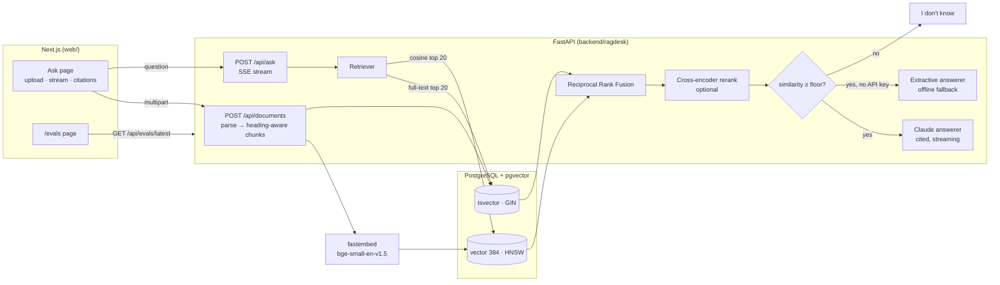

# ragdesk

A production-style Retrieval-Augmented Generation (RAG) app with an evaluation harness. Upload Markdown, HTML or PDF documents, ask questions, and get streamed answers with clickable citations, or "I don't know" when the documents don't cover the question.

- **Backend:** Python 3.12, FastAPI, PostgreSQL + pgvector, `fastembed` (local ONNX embeddings and reranker), Anthropic SDK
- **Frontend:** Next.js (App Router), TypeScript, Tailwind CSS
- **Retrieval:** Postgres full-text search plus vector similarity, fused with Reciprocal Rank Fusion, with an optional cross-encoder rerank
- **Runs without any API key:** with no `ANTHROPIC_API_KEY`, a deterministic extractive answerer quotes and cites the best-matching sentences

## Architecture



**Request flow for `/api/ask`:** the question is embedded and sent to both the vector index and the full-text index (20 candidates each). The two rankings are fused with RRF and optionally reranked by a cross-encoder. The top 5 chunks are kept. If the best cosine similarity is under the configured floor, the API answers "I don't know" without calling the LLM. Otherwise the chunks go to the answerer as numbered sources. The response is a server-sent event stream: `sources` (the numbered chunks), then `token` events, then `done` (refused, answerer, confidence). If something fails mid-stream, the API sends an `error` event so the stream doesn't just stop silently.

## Quickstart

### Docker (Postgres + API + web)

```bash
cp .env.example .env            # optional: add ANTHROPIC_API_KEY
docker compose up --build
```

Open http://localhost:3000. On first start, the API indexes the bundled sample corpus (`backend/corpus/`, docs for a fictional job scheduler called "Kestrel"). The embedding and reranker models are downloaded into the image at build time.

### Local development

Requires [uv](https://docs.astral.sh/uv/) and Node 20+.

```bash
# API (in-memory store, offline extractive answers; first run downloads the bge-small embedding model)
cd backend
uv sync
uv run uvicorn ragdesk.api:app --reload

# Web
cd web
npm install
npm run dev
```

To use Postgres, set `DATABASE_URL` (the database needs the `vector` extension available). To get LLM answers, set `ANTHROPIC_API_KEY`. The default model is `claude-haiku-5-5`, which you can override with `ANTHROPIC_MODEL`. Set `EMBEDDER=hash` to skip the model download entirely. See [`.env.example`](.env.example) for every setting.

### API

| Method | Path | Purpose |
|---|---|---|
| `GET` | `/api/health` | store, embedder, answerer, chunk count |
| `GET` | `/api/documents` | indexed documents with chunk counts |
| `POST` | `/api/documents` | multipart upload (`files`): `.md .markdown .txt .html .htm .pdf`, 10 MB max each; re-uploading a name replaces it |
| `POST` | `/api/search` | `{query, k, mode: vector\|fulltext\|hybrid, rerank}` → ranked chunks (debugging) |
| `POST` | `/api/ask` | `{question, k?, mode?}` → `text/event-stream` |
| `GET` | `/api/evals/latest` | latest `eval/results.json` |

## Evaluation

`backend/eval/` contains a golden set of **50 in-scope questions and 10 out-of-scope questions** over the bundled corpus (11 documents, 70 chunks). Every in-scope question lists one or more relevant `(document, evidence phrase)` pairs. A retrieved chunk counts as relevant if it comes from that document and contains the phrase. Because relevance is defined this way, the labels don't depend on chunk boundaries, so the chunker can change without relabelling the set.

```bash
cd backend
uv run python -m eval.run_eval --rerank                          # in-memory store
uv run python -m eval.run_eval --rerank --database-url "$URL"    # Postgres (TRUNCATES its tables; use a scratch DB)
uv run python -m eval.run_eval --judge                           # + LLM-as-judge faithfulness (needs ANTHROPIC_API_KEY)
```

### Results

These are the numbers from the committed [`backend/eval/results.json`](backend/eval/results.json): PostgreSQL 16 + pgvector 0.6.2, `fastembed` BAAI/bge-small-en-v1.5, k = 10, measured on an Apple Silicon laptop (CPU only).

| Mode | Recall@1 | Recall@3 | Recall@5 | MRR@10 | p50 latency |
|---|---|---|---|---|---|
| vector only | 0.700 | 0.900 | 0.920 | 0.808 | 3.2 ms |
| full-text only (`ts_rank`) | 0.760 | 0.940 | 0.940 | 0.845 | 3.3 ms |
| hybrid (RRF) | 0.720 | 0.940 | 0.980 | 0.833 | 3.3 ms |
| hybrid + cross-encoder rerank | **0.900** | **1.000** | **1.000** | **0.943** | 377 ms |

Latency covers embedding the query plus the database round trips. Every mode embeds the query, because the refusal gate needs the vector similarity.

The same eval on the **in-memory store**, which uses real BM25 instead of `ts_rank`:

| Embedder | Mode | Recall@1 | Recall@3 | Recall@5 | MRR@10 |
|---|---|---|---|---|---|
| fastembed | vector | 0.700 | 0.900 | 0.920 | 0.808 |
| fastembed | BM25 | 0.740 | 0.920 | 0.940 | 0.825 |
| fastembed | hybrid | 0.760 | 0.960 | 0.960 | 0.858 |
| hash (test fallback) | vector | 0.480 | 0.680 | 0.820 | 0.608 |
| hash (test fallback) | hybrid | 0.580 | 0.860 | 0.900 | 0.725 |

**What the numbers say:**

- On this corpus, hybrid fusion improves *coverage*. Recall@5 rises from 0.92–0.94 to 0.98 on Postgres. It does not improve *ordering*: MRR@10 is 0.833 for hybrid against 0.845 for full-text alone. The questions are full of exact identifiers (`KST-4102`, `max_concurrency`, `/readyz`), which favours lexical search. RRF also gives a weak retriever an equal vote, which can push a correct rank-1 lexical hit down.
- The reranker accounts for the biggest gain, but it costs about 375 ms per query on CPU, so it is opt-in (`RERANK=1`, on by default in `docker-compose.yml`).
- With the hash embedder, which only sees overlapping words, hybrid search is *worse* than full-text alone. RRF can't fix one bad input ranking.
- The eval drove one change: `ts_rank_cd` gave full-text MRR@10 of 0.741 and `ts_rank` gave 0.845, so the store now uses `ts_rank`. Cover density rewards query terms that appear close together, which fits AND queries but not the OR-of-terms queries this app builds.

**Refusal gate.** At the default floor (cosine ≥ 0.65), **100% of in-scope questions are answered and 50% of out-of-scope questions are refused** before the LLM is called. The two groups' confidence ranges overlap: in-scope questions score 0.652–0.904 and out-of-scope 0.459–0.771. Raising the floor to 0.72, the best value on this set, refuses 90% of out-of-scope questions but also refuses 20% of answerable ones. So the gate only catches clearly off-topic questions cheaply. On-topic but unanswerable questions, like "Is there an official Python SDK?", are left to the LLM, which is prompted to say "I don't know". These thresholds were tuned on the same 60 questions they are reported on, so read them as calibration data, not held-out accuracy.

**Offline answers.** With hybrid + rerank retrieval, **84%** of the extractive answerer's responses contain the gold evidence phrase.

**Faithfulness (LLM-as-judge)** is implemented (`--judge`: Claude answers, `claude-opus-5-5` judges each answer against its sources with a JSON-schema verdict). It has **not been run**, because no API key was available while building this. The results file records `"faithfulness": null` until someone runs it.

## Design trade-offs

- **Heading-aware chunking.** Markdown and HTML are split on headings into sections first, so a chunk never spans two sections. Sections are then packed paragraph by paragraph into chunks of up to 800 characters, with about 120 characters of overlap on word boundaries. Each chunk is embedded and indexed with its heading breadcrumb (`Retries > Dead-letter queue`) in front, so short chunks keep their context. PDFs have no reliable heading structure, so they are chunked per page.
- **RRF instead of score blending.** Cosine similarity and `ts_rank` are on unrelated scales. RRF only uses ranks, so there are no normalization constants to tune. The downside is that a confident first-place result from one retriever counts for no more than a weak one (see the results above).
- **Postgres for both indexes.** One database holds the documents, the `tsvector` (GIN index) and the embeddings (HNSW index), so there's no separate vector database to deploy or keep in sync. The `tsvector` is a generated column weighted heading = A, body = B. Queries OR their terms together because `websearch_to_tsquery` ANDs them, which returns nothing for most natural-language questions.
- **Store interface with two implementations.** `PgStore` is the production store. `InMemoryStore` (BM25 + brute-force cosine) lets tests, the eval and demos run without a database. The same contract tests run against both. The Postgres tests get a real Postgres + pgvector from `pgserver` (a pip package), so they need no Docker, and CI uses a `pgvector/pgvector` service container instead.
- **Local embeddings.** `bge-small-en-v1.5` runs on CPU through ONNX: there's no paid embedding API and no data leaves the machine. The `hash` embedder is deterministic and needs no download, so tests are fast and reproducible.
- **Cheap refusal before the LLM.** The similarity gate costs no tokens and catches clearly off-topic questions. The finer "is this actually answered?" decision is left to the LLM, which is given only the numbered sources and told to treat their text as data, not instructions. This is a basic guard against prompt injection hidden in uploaded documents.
- **Streaming over POST.** The browser's `EventSource` can only send GET requests, so the frontend reads the SSE stream from `fetch` and parses it itself (about 25 lines in `web/lib/api.ts`).

### Known limitations

- The sample corpus is small (70 chunks), and the golden set was written by the same person who wrote the corpus. Absolute scores will be lower on a large, messy real corpus. The *relative* comparison between modes is the useful part.
- `PgStore` uses a single connection (psycopg serializes access). Use `psycopg_pool` before serving real concurrent traffic.
- There's no auth, no multi-tenancy, and no document deletion endpoint.
- PDF extraction is plain text per page through `pypdf`. Scanned PDFs (images with no text layer) need OCR, which isn't included.

## Tests

```bash
cd backend && uv run pytest        # 41 tests: chunker, RRF, BM25/vector/hybrid ranking, answerers, API + SSE
uv run ruff check . && uv run ruff format --check .
cd web && npm run lint && npm run build
```

The store contract tests run against both `InMemoryStore` and a real Postgres + pgvector. They use `RAGDESK_TEST_DATABASE_URL` if it is set, and otherwise start a throwaway server with `pgserver`. The Claude answerer is tested with a stubbed SDK stream, since no key is needed or used.

## Layout

```
backend/
  ragdesk/      chunker · embeddings · store (memory, postgres) · retrieval (RRF, rerank) · answer · rag · api
  eval/         golden.py (60 questions) · run_eval.py · results.json
  corpus/       fictional "Kestrel" docs (Markdown + HTML), written for this project
  tests/
web/            Next.js app: / (ask + upload), /evals
```

## License

MIT. The sample corpus is original fictional documentation written for this repository.
